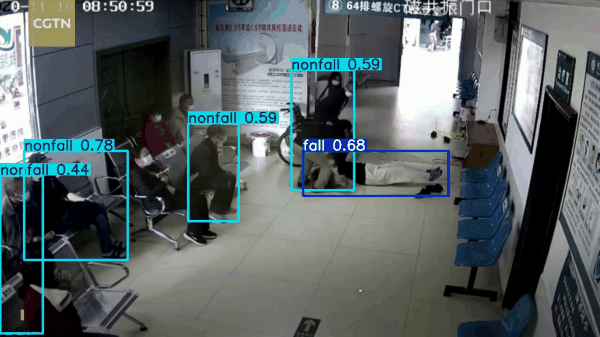
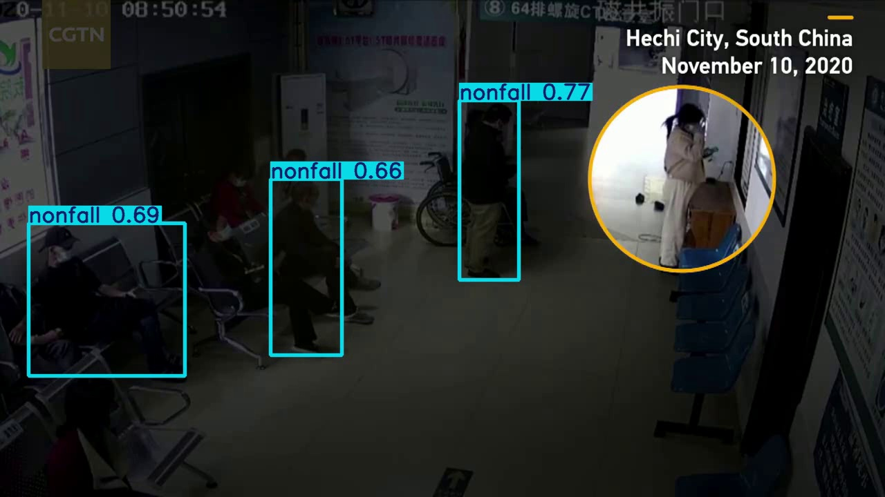
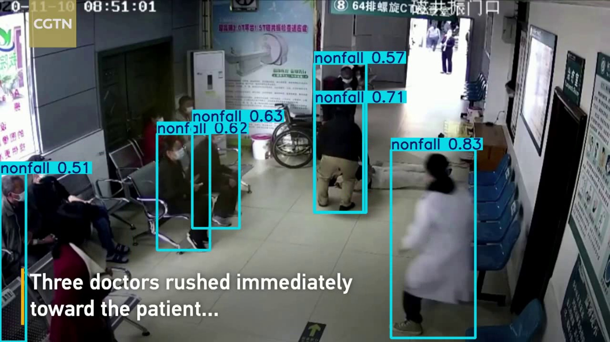
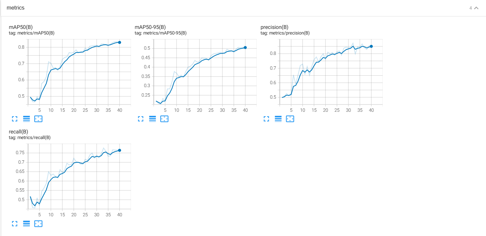
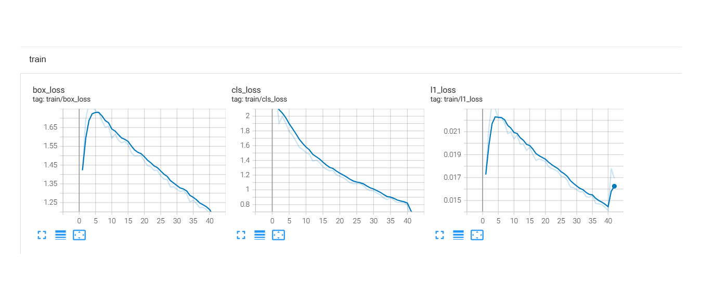
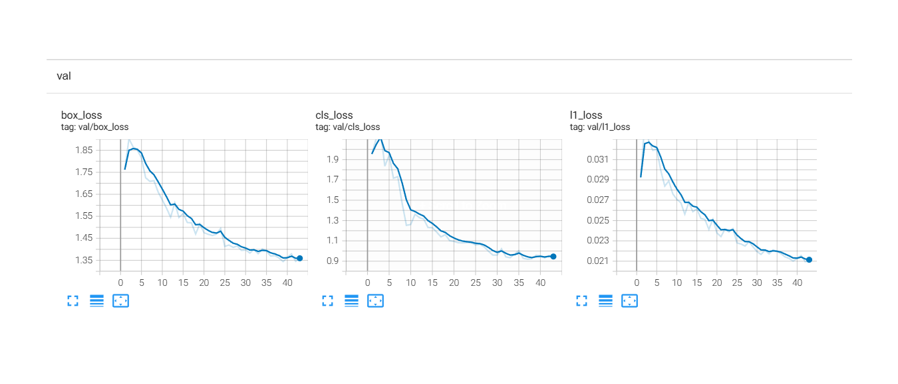
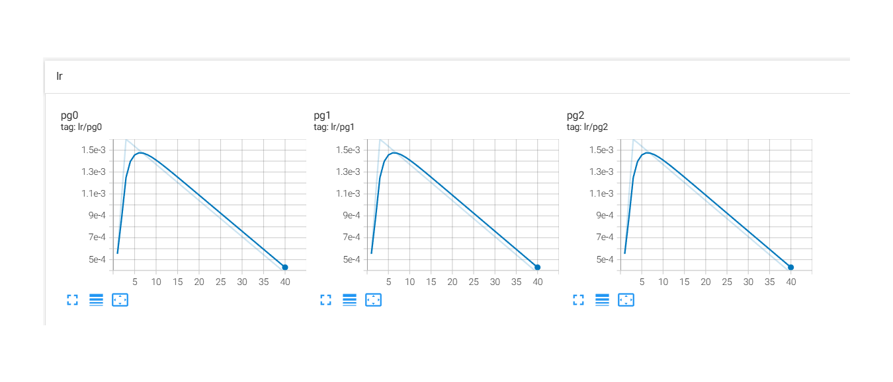
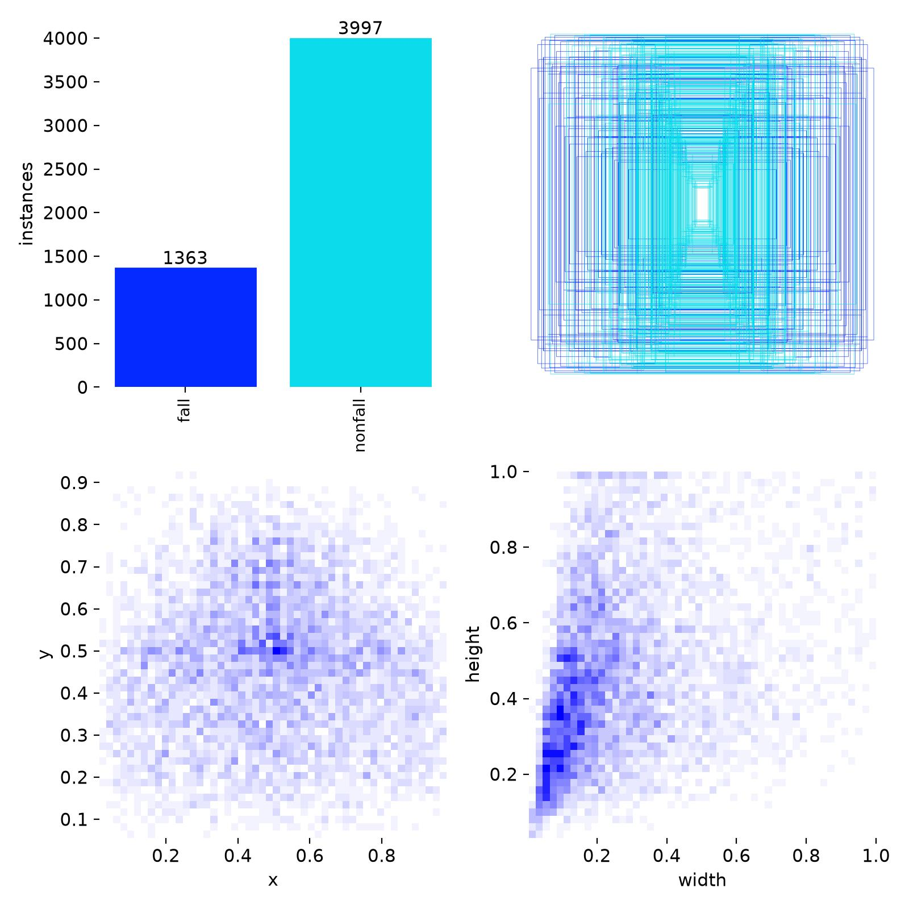
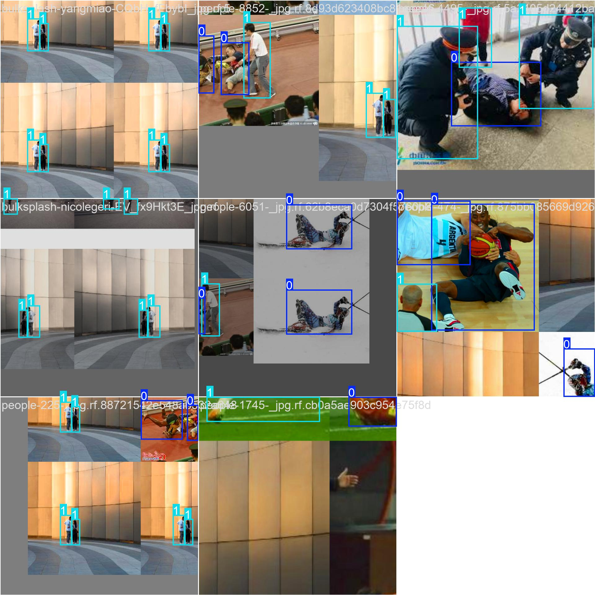

# 🦺 Vin Perception Hackathon — Track 4 Capstone
# 🏥 Hệ Thống Phát Hiện Té Ngã Thời Gian Thực Bằng YOLO (Real-time Fall Detection)

<div align="center">

[](https://www.python.org/)
[](https://github.com/ultralytics/ultralytics)
[](https://pytorch.org/)
[](https://universe.roboflow.com)
[](index.html)

**Đội thi:** Team BetBetBet  
**Chương trình:** Vin Perception Hackathon — Track 4 (Computer Vision & Robotics) | AI20k  
**Bài toán ứng dụng:** Giám sát an toàn thông minh cho bệnh viện **Vinmec** & đô thị **Vinhomes**

</div>

---

## 🎬 1. Demo Kết Quả Dự Đoán Thời Gian Thực (Inference Video Demo)

Mô hình được thử nghiệm trực tiếp trên video thực tế tại hành lang bệnh viện (**`VideoTest/Doctors rush to help patient who falls suddenly on hospital floor.mp4`**):

<div align="center">
  
  <p><em>🎥 <b>Ảnh động Demo:</b> Nhận diện chính xác khoảnh khắc bệnh nhân té ngã xuống sàn hành lang và kích hoạt cảnh báo tức thời.</em></p>
</div>

### 🔍 So sánh Trực quan Trước và Khi Xảy Ra Té Ngã

| 🚶 Trạng thái Hoạt động Bình thường | 🚨 Khoảnh khắc Phát hiện Té ngã |
| :---: | :---: |
|  |  |
| *Mọi người di chuyển, sinh hoạt bình thường: Nhãn **`nonfall`**.* | *Bệnh nhân ngã xuống sàn: Lập tức gán nhãn cảnh báo **`fall`**, các bác sĩ/nhân viên y tế chạy tới cấp cứu duy trì nhãn **`nonfall`**.* |

---

## 📌 2. Giới Thiệu Đề Tài & Bối Cảnh Thực Tế

Té ngã là một trong những rủi ro nguy hiểm nhất đe dọa sức khỏe của người già, bệnh nhân đột quỵ, người có tiền sử tim mạch hoặc bệnh nhân sau phẫu thuật. Tại các cơ sở y tế lớn hoặc khu dân cư, việc nhân viên trực 24/7 theo dõi từng màn hình camera là bất khả thi.

Dự án của **Team BetBetBet** giải quyết bài toán:
- **Tự động hóa phát hiện sự cố:** Phát hiện hành vi té ngã tức thời từ camera an ninh thông thường mà không yêu cầu người dùng phải đeo cảm biến cơ thể (wearable sensors).
- **Tích hợp vào Hệ sinh thái Vin:**
  - **Vinmec:** Lắp đặt tại các buồng hồi sức, hành lang và nhà vệ sinh viện Vinmec. Khi người bệnh trượt ngã, hệ thống kích hoạt chuông báo và gửi cảnh báo đỏ trực tiếp đến ứng dụng trực ban điều dưỡng.
  - **Vinhomes / VinFast Smart Space:** Giám sát an toàn cho người cao tuổi sống một mình tại các căn hộ thông minh Vinhomes.

---

## 📊 3. Báo Cáo Kết Quả Huấn Luyện (Training Report & Evaluation)

### 📈 Đồ thị Chỉ số Đánh giá & Hàm Mất mát

Toàn bộ quá trình huấn luyện qua 48 epochs được ghi nhận tự động:

| 🎯 Đồ thị Chỉ số Đo lường (Metrics) | 📉 Hàm mất mát Huấn luyện (Train Loss) |
| :---: | :---: |
|  |  |
| **Độ hội tụ Tập Xác thực (Validation Loss)** | **Lịch trình Tốc độ học (Learning Rate)** |
|  |  |

### 🏆 Bảng Thông Số Chi Tiết

| Chỉ số Đánh giá (Metric) | Kết quả Đạt được | Diễn giải & Đánh giá |
| :--- | :---: | :--- |
| **Precision (B)** | **87.6%** | Độ chính xác cao, giảm thiểu tối đa các cảnh báo giả gây hoang mang |
| **Recall (B)** | **79.3%** | Khả năng phát hiện nhạy bén, tránh bỏ sót các ca té ngã thực tế |
| **mAP@50** | **84.1%** | Độ chính xác trung bình vượt trội ở ngưỡng giao nhau IoU 0.5 |
| **mAP@50-95** | **51.8%** | Thể hiện khả năng định vị bounding box khít và chuẩn xác |
| **Tốc độ Inference** | **~50 ms/frame (~20 FPS)** | Đạt chuẩn xử lý thời gian thực trên GPU NVIDIA |

---

## 📦 4. Dữ Liệu & Phân Tích Dataset

Dataset bao gồm hơn 2.000 hình ảnh đa dạng về góc máy, độ sáng và bối cảnh (phòng bệnh, sàn nhà, cầu thang, ngoài trời), được chuẩn hóa thành 2 lớp đối tượng:
- **`0: fall`**: Người đang nằm bệt, trượt chân hoặc té ngã trên mặt phẳng.
- **`1: nonfall`**: Người đứng, đi lại, ngồi ghế, cúi người hoặc sinh hoạt bình thường.

| 🏷️ Phân bố Nhãn & Bounding Box | 🖼️ Mẫu Batch Huấn luyện (Augmentations) |
| :---: | :---: |
|  |  |

---

## 🧠 5. Các Trụ Cột Kiến Thức Track 4 Đã Vận Dụng

Dự án sử dụng **4 trên 7 trụ cột** của Track 4. Bảng dưới chỉ rõ từng trụ cột nằm ở đâu trong hệ thống và vì sao team chọn cách làm đó.

| Trụ cột | Nằm ở đâu trong hệ thống | Vì sao chọn cách này |
| :--- | :--- | :--- |
| **Học** | `TrainingYOLO.py`: fine-tune YOLO pretrained trên tập Roboflow Fall-Detection (2 lớp `fall` / `nonfall`). | Chỉ có thời gian ngắn và GPU 6GB nên không train từ đầu. Fine-tune model pretrained cho kết quả tốt hơn nhiều với ~2.000 ảnh. |
| **Dữ liệu** | `convert_to_yolo.py`: chuyển nhãn CSV sang định dạng YOLO, loại box suy biến (`xmax <= xmin`), chuẩn hóa tọa độ về [0, 1]; chia train/val/test; `Report/labels_distribution.jpg`. | Nhãn sai hoặc box lỗi làm hỏng loss. Làm sạch trước khi train, và xem phân bố nhãn để biết hai lớp có cân bằng không. |
| **Biểu diễn** | Đầu ra của model là bounding box + lớp (`fall` / `nonfall`) + độ tin cậy cho từng người trong khung hình. | Bounding box đủ để phân biệt người đang nằm với người đứng. Nó nhẹ hơn ước lượng khớp xương nên chạy được thời gian thực, đổi lại mất thông tin về tư thế chi tiết. |
| **Bằng chứng** | Mục 3 (Precision, Recall, mAP@50, mAP@50-95, đồ thị loss) và mục 8 (ca lỗi và giới hạn). | Mỗi kết luận đều dựa trên số đo. Ca lỗi được nêu cùng nguyên nhân (góc nhìn từ trên xuống, bị che khuất, người nằm nghỉ chủ động). |

**Về trụ cột Bất định:** ngưỡng `--conf 0.7` trong `InferenceYOLO.py` là cách xử lý độ tin cậy ở mức cơ bản: dự đoán dưới ngưỡng bị bỏ qua để giảm báo động giả, đổi lại có thể bỏ sót một số ca.

**Chưa làm (hướng phát triển):** trụ cột **Thời gian** (chỉ báo động khi `fall` kéo dài liên tục, đo độ trễ từ ảnh đến cảnh báo) và **Hình học** (góc nghiêng thân người so với mặt sàn). Xem mục 8 (Hướng mở rộng tiếp theo).

---

## 🗂️ 6. Cấu Trúc Thư Mục Dự Án

```text
K4-Track4-Capstone-Team-BetBetBet/
├── Report/                                # Toàn bộ hình ảnh báo cáo & demo cho README
│   ├── fall_detection_demo.gif            # Ảnh động trích xuất kết quả phát hiện té ngã
│   ├── fall_detected_keyframe.jpg         # Keyframe khoảnh khắc phát hiện té ngã
│   ├── normal_keyframe.jpg                # Keyframe trạng thái hoạt động bình thường
│   ├── Metric.png                         # Biểu đồ Precision, Recall, mAP50, mAP50-95
│   ├── Train.png                          # Đồ thị train box_loss, cls_loss, dfl_loss
│   ├── Validate.png                       # Đồ thị validation loss
│   ├── Learningrate.png                   # Lịch trình learning rate
│   ├── labels_distribution.jpg            # Phân bố không gian bounding box
│   └── train_batch_sample.jpg             # Mẫu mosaic batch tăng cường dữ liệu
├── VideoTest/                             # Thư mục chứa các video kiểm thử thực tế
│   └── Doctors rush to help patient...mp4 # Video test tình huống cấp cứu tại bệnh viện
├── runs/detect/                           # Checkpoint trọng số và kết quả suy luận
│   ├── fall_detection_exp-2/weights/      # best.pt, last.pt
│   └── predict_doctors_rush/              # Video kết quả sau khi suy luận (.avi)
├── convert_to_yolo.py                     # Tiền xử lý dữ liệu và tự động sinh data.yaml
├── TrainingYOLO.py                         # Huấn luyện YOLO với cơ chế tối ưu VRAM & Resume
├── InferenceYOLO.py                        # Dự đoán trên video, webcam hoặc hình ảnh
├── data.yaml                              # File cấu hình tập dữ liệu Ultralytics YOLO
├── index.html                             # Trang đề bài & tiêu chí Vin Perception Hackathon
└── README.md                              # Tài liệu dự án hiển thị trên GitHub
```

---

## ⚡ 7. Hướng Dẫn Cài Đặt & Chạy Trực Tiếp

### 🛠️ Bước 1: Chuẩn bị Môi trường

```bash
# Clone repository
git clone https://github.com/anhkhoi130605/K4-Track4-Capstone-Team-BetBetBet.git
cd K4-Track4-Capstone-Team-BetBetBet

# Cài đặt PyTorch hỗ trợ GPU CUDA (Khuyên dùng CUDA 12.1 hoặc 11.8)
pip install torch torchvision --index-url https://download.pytorch.org/whl/cu121

# Cài đặt Ultralytics và các thư viện bổ trợ
pip install ultralytics pandas opencv-python matplotlib Pillow
```

---

### 🔄 Bước 2: Chuẩn bị Dữ liệu (Dataset Pipeline)

Script [convert_to_yolo.py](file:///d:/VinUni/DeepTrack/K4-Track4-Capstone-Team-BetBetBet/convert_to_yolo.py) tự động quét nhãn Roboflow CSV, loại trừ box suy biến, chuẩn hóa tọa độ và tạo [data.yaml](file:///d:/VinUni/DeepTrack/K4-Track4-Capstone-Team-BetBetBet/data.yaml):

```bash
python convert_to_yolo.py
```

---

### 🏋️ Bước 3: Huấn luyện Mô hình (Training)

Script [TrainingYOLO.py](file:///d:/VinUni/DeepTrack/K4-Track4-Capstone-Team-BetBetBet/TrainingYOLO.py) đã tích hợp sẵn cơ chế chống phân mảnh bộ nhớ VRAM trên Windows (`PYTORCH_CUDA_ALLOC_CONF=expandable_segments:True`):

```bash
# Huấn luyện mô hình từ đầu
python TrainingYOLO.py --model yolo26m.pt --epochs 50 --batch 8 --imgsz 640 --device 0

# Tiếp tục huấn luyện khi bị ngắt quãng (Resume checkpoint)
python TrainingYOLO.py --resume
```

---

### 🎥 Bước 4: Chạy Suy Luận Dự Đoán (Inference)

File [InferenceYOLO.py](file:///d:/VinUni/DeepTrack/K4-Track4-Capstone-Team-BetBetBet/InferenceYOLO.py) đã được cấu hình sẵn video test **`Doctors rush...`**:

```bash
# 1. Chạy dự đoán trên video Doctors Rush (mặc định lưu kết quả vào runs/detect/predict_doctors_rush/):
python InferenceYOLO.py

# 2. Chạy hiển thị cửa sổ GUI thời gian thực (phù hợp demo trực tiếp):
python InferenceYOLO.py --show

# 3. Thử nghiệm trực tiếp bằng Webcam laptop / PC:
python InferenceYOLO.py --source 0 --show
```

---

## 🧐 8. Đánh Giá Ca Lỗi & Hướng Phát Triển (Failure Cases & Future Work)

### ⚠️ Phân tích Ca lỗi Thực tế (Failure Cases)
1. **Góc máy thẳng đứng (Top-down view):** Khi camera gắn thẳng trên trần chiếu vuông góc xuống sàn, tư thế nằm và tư thế ngồi khoanh chân có tỷ lệ hình thể tương đồng, dễ gây nhiễu nhận diện.
2. **Vật cản che khuất (Occlusion):** Người bệnh ngã phía sau giường bệnh, bàn ghế hoặc bị chăn mền che phủ một phần cơ thể có thể làm giảm độ tin cậy của bounding box.
3. **Tư thế nằm nghỉ chủ động:** Người nằm ngủ hoặc tập thể dục trên sàn nhà đôi khi có thể bị nhận định nhầm là té ngã nếu chỉ dựa vào một khung hình đơn lẻ.

### 🚀 Hướng mở rộng tiếp theo
- **Tích hợp Theo dõi Theo Thời gian (Temporal Tracking):** Bổ sung bộ đếm thời gian (ví dụ: chỉ phát chuông báo động đỏ nếu đối tượng ở trạng thái `fall` liên tục trên 5 giây).
- **Kết hợp YOLO-Pose (Ước lượng Khớp xương):** Tính toán góc nghiêng giữa trục xương sống và mặt sàn cùng tốc độ thay đổi độ cao đột ngột của trọng tâm cơ thể để đạt độ tin cậy 99%.
- **Triển khai Edge AI (NVIDIA Jetson / Raspberry Pi):** Tối ưu hóa mô hình sang định dạng **TensorRT** để chạy trực tiếp trên camera biên tại bệnh viện với chi phí phần cứng thấp.

---

## 👥 9. Đội Ngũ Thực Hiện (Team BetBetBet)

- **Đơn vị:** Track 4 (Computer Vision & Robotics) — Vin Perception Hackathon
- **Mã nguồn:** [GitHub Repository](https://github.com/anhkhoi130605/K4-Track4-Capstone-Team-BetBetBet)
- **Bản quyền:** Dự án phát triển cho kỳ Hackathon Capstone AI20k.
